# 3D Improved U-Net for HipMRI Prostate Radiotherapy Segmentation

## Abstract

This study investigates the spatial-context dilemma in COMP3710 Section 2.2: whether a volumetric segmentation model produces clinically useful improvements at prostate boundaries and slice transitions that justify its additional memory cost. A residual 3D Improved U-Net with deep supervision is compared with a slice-wise 2D U-Net baseline on 211 longitudinal HipMRI volumes from 38 patients. The comparison controls the patient-level split, preprocessing, labels, loss family, and held-out cases. Evaluation covers voxel overlap, prostate boundary agreement, errors at both ends of the annotated prostate extent, GPU allocation, inference latency, and five matched failure cases.

Across 26 test volumes from five held-out patients, the 3D model achieved prostate Dice **0.7896**, above the required 0.70 threshold and higher than the baseline's **0.7679**. Prostate boundary F1 increased from **0.9236 to 0.9311**, and the 3D model produced fewer predictions beyond the ground-truth slice span. These gains did not generalise across organs: mean foreground Dice decreased from **0.8698 to 0.8312**, largely because bladder Dice fell from **0.8564 to 0.6505**. The evidence therefore supports the 3D model only as a research-stage prostate contour proposal requiring specialist review. It does not support autonomous use or replacement of the 2D baseline for multi-organ contouring.

## Research question and experimental scope

The intended user is a radiation oncology imaging specialist who reviews and corrects proposed contours. The primary question is not simply which model has the highest global Dice score, but whether volumetric context reduces hazardous local errors near the ends of the prostate and at adjacent organ boundaries. The experiment compares complete, practically deployable configurations: the proposed model changes dimensionality, residual processing, deep supervision, dropout, activation, downsampling, and channel width. It is therefore an operational comparison rather than a causal ablation of 3D context alone.

The six output classes are:

| ID | Class | Mask-overlay colour |
|---:|---|---|
| 0 | Background | Transparent (black in the raw palette) |
| 1 | Body | Grey (`#aaaaaa`) |
| 2 | Bone | Yellow (`#f1c40f`) |
| 3 | Bladder | Blue (`#3498db`) |
| 4 | Rectum | Orange (`#e67e22`) |
| 5 | Prostate | Pink/magenta (`#e84393`) |

These are this project's display colours, not a colour convention taken from the papers. In the **error panel**, red means prostate false positive, blue means prostate false negative, and yellow means disagreement involving other labels. Error colours have a different meaning from organ colours. Transparency blends the colours with the MRI.

## Methods

### Model architectures

The 2D baseline is a standard U-Net-style architecture adapted with GroupNorm and padded convolutions. It uses four encoder downsampling stages and a bottleneck (five spatial resolutions), double 3 x 3 convolutions, skip concatenations, and a 1 x 1 classification head. Each downsampled axial slice is processed independently, so the model cannot directly use neighbouring slices.

The 3D implementation combines volumetric U-Net operations from Çiçek et al. [2] with residual context processing, dropout, and deep supervision inspired by Isensee et al. [3]. It has four encoder downsampling stages and a bottleneck, using 3D convolutions and skip concatenations together with residual blocks and two auxiliary decoder heads. The auxiliary heads provide additional supervision at intermediate decoder resolutions during training and are removed at inference. Both models use GroupNorm, so normalisation is controlled rather than confounded between configurations. Their default widths differ: 32 channels for the 2D baseline and 16 for the 3D model. The smaller 3D width limits memory demand but also prevents the comparison from being interpreted as a matched-capacity dimensionality experiment.

### Architectural provenance and departures from the literature

The cited papers motivate architectural choices; none reports HipMRI results for this implementation. The models are adaptations rather than reproductions of the original training and inference pipelines.

| Reference | Ideas retained here | Material differences in this project |
|---|---|---|
| Ronneberger et al. [1], Secs. 2-3, pp. 237-239 | Contracting/expanding paths; paired 3 x 3 convolutions; max pooling; up-convolutions; concatenated skips; 1 x 1 classifier | Padded convolutions preserve image size, so cropped skips and overlap-tile inference are unnecessary here. Base width is 32 instead of the paper's 64; GroupNorm is added. We use AdamW, weighted cross-entropy plus foreground Dice, and simple flip/intensity augmentation rather than the paper's SGD, spatial border-weighted cross-entropy and elastic augmentation. Our baseline has no dropout. |
| Cicek et al. [2], Sec. 2, pp. 426-427 | 3D encoder-decoder operations and same-resolution feature connections for volumetric segmentation | The paper uses max pooling, batch normalization, and a loss that ignores unlabelled voxels in sparsely annotated Xenopus kidney microscopy. We use densely labelled pelvic MRI, residual blocks, GroupNorm, strided convolutions, padded outputs and auxiliary losses. Our training uses entire resized volumes rather than the paper's input tiles. |
| Isensee et al. [3], Sec. 2.1, pp. 289-291 | Residual context processing; multi-scale segmentation supervision; leaky ReLU with slope 0.01; dropout; Dice-based optimisation; base width 16 | The block ordering, normalization, down/up-sampling, decoder, supervision formulation and training protocol differ as detailed below. |

In [3], the context modules are pre-activation residual blocks with instance normalisation and dropout of 0.3. Strided 3 x 3 x 3 convolutions downsample, repeated-voxel upsampling followed by convolution restores resolution, and multi-scale segmentation outputs are summed into the final prediction. This implementation instead uses GroupNorm, post-addition activation, dropout up to 0.15, stride-2 kernels of size 2, and transposed-convolution upsampling followed by residual decoder blocks. Its two auxiliary heads receive separate losses weighted 0.4 and 0.2; their logits are not summed into the inference output. These departures are substantive and should be considered when relating the observed results to [3].

Isensee et al. train on 128 x 128 x 128 patches with batch size 2, Adam, multiclass Dice, extensive augmentation, test-time augmentation, and a five-model ensemble. This study uses one MRI channel, six HipMRI labels, whole resized 64 x 128 x 128 volumes, batch size 1, AdamW with cosine decay, and one checkpoint per model without test-time augmentation. Foreground percentile clipping and z-normalisation also differ from the brain-region normalisation in [3]. Residual learning and deep supervision are therefore literature-motivated design choices whose individual contributions on HipMRI remain unmeasured.

### Training objective

For both models, the main segmentation objective is:

```text
main loss = 0.4 * weighted cross-entropy
          + 0.6 * mean foreground soft-Dice loss
```

Cross-entropy class weights are `[0.05, 0.35, 1.0, 2.0, 2.0, 4.0]`. Integer masks are converted internally to six-channel one-hot masks for the soft-Dice calculation. During 3D training only, the optimisation objective is `main + 0.4 * auxiliary_1 + 0.2 * auxiliary_2`; validation and test reporting use the main output. AdamW and cosine learning-rate decay are shared. The Dice reduction is per slice for 2D and per volume for 3D; 2D weighted cross-entropy is also reduced within slice sub-batches. Therefore the loss family is shared, but numerical loss values are not identical objectives or a direct measure of which model is better.

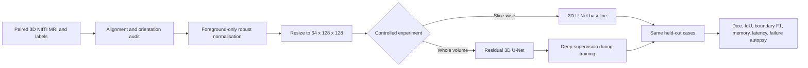

### Implementation map

The report is self-contained at the level of methods, numerical results, and representative figures. The implementation is organised as follows:

- `modules.py` - model components, loss, and model factory.
- `dataset.py` - case discovery, patient splitting, NIfTI validation, preprocessing, and augmentation.
- `train.py` - training, validation, testing, early stopping, checkpoints, curves, and resource profiling.
- `predict.py` - held-out inference, per-case metrics, NIfTI export, and four-panel failure figures.
- `utils.py` - segmentation metrics, boundary F1, regional analysis, and inference helpers.
- `compare_results.py` - checks that both runs contain the same cases and produces aggregate and paired comparisons.
- `figures/` - training curves and matched failure-case figures included with this report.
- `requirements.txt` - requested package versions for a reproducible environment.

## Feasibility review - compulsory midpoint check-off


### User need, scope, and acceptance criteria

The proposed prototype assists radiation oncology imaging specialists by generating anatomical contours from pelvic MRI for expert review and correction. It segments body, bone, bladder, rectum, and prostate without making autonomous treatment decisions.
The initial acceptance criteria were:
1. Ensure patient-level separation across training, validation, and test sets.
2. Achieve held-out prostate Dice ≥ 0.70 for the 3D model.
3. Compare 2D and 3D models on identical test cases using Dice, IoU, and boundary metrics.
4. Analyse 3–5 representative segmentation failures.
5. Fit a complete downsampled volume on one Rangpur A100 and measure memory usage and inference latency.

### Model choice and course concepts

The selected hard-difficulty model is a 3D Improved U-Net trained on downsampled HipMRI volumes, compared against a standard 2D U-Net baseline. The 2D model processes individual slices, while the 3D model incorporates neighbouring-slice information through volumetric convolutions. Residual blocks process contextual features, deep supervision provides auxiliary segmentation signals at multiple resolutions, and U-Net skip connections transfer higher-resolution encoder features into the decoder. Patient-level splitting prevents leakage between weekly scans, while class weighting and foreground Dice loss address class imbalance. The comparison assesses overall model performance and computational cost rather than isolating the effects of 3D convolutions.

### Preliminary feasibility evidence - smoke test only

Slurm job successfully ran both models for one epoch using two cases per split, automatic mixed precision, 64 × 128 × 128 resolution, batch size 1, and an NVIDIA A100-PCIE-40GB. An audit confirmed that all 211 MRI-label pairs were aligned and consistently oriented.
The 2D and 3D models achieved validation foreground Dice scores of 0.1115 and 0.0955, respectively. Peak training GPU allocations were 929.04 MiB (2D) and 1,525.58 MiB (3D), while whole-volume inference times were 27.38 ms and 27.62 ms per case. These preliminary results demonstrate pipeline functionality and resource feasibility, not final segmentation accuracy. Both models successfully completed training and inference on a single A100.

### Risks, budget, next experiment, and fallback

Key risks include class imbalance, loss of small structures during downsampling, orientation errors, patient leakage, overfitting on only 38 patients, and increased 3D memory requirements.
The planned experiment uses up to 80 epochs, early-stopping patience 20, one A100, four CPU workers, and a four-hour Slurm limit per model. Both models will be trained under identical data settings and evaluated on the same held-out patients. If the 3D model exceeds available memory, its channel width will be reduced before further downsampling. The working 2D U-Net remains the fallback.

## Data and preprocessing

### Dataset and provenance

The course-provided HipMRI dataset contains 211 labelled pelvic MRI volumes from 38 patients. Each volume is paired with a segmentation containing body, bone, bladder, rectum, and prostate labels. Several patients contribute multiple longitudinal volumes, so a volume-level random split could place scans from the same patient in different partitions and leak patient-specific anatomy across training and evaluation.

Rangpur data location:

```text
/home/groups/comp3710/HipMRI_Study_open/
  semantic_MRs/*_LFOV.nii.gz
  semantic_labels_only/*_SEMANTIC.nii.gz
```

The dataset, trained checkpoints, and raw experiment directories are deliberately not required to read this report and should not be committed to the repository. The tables below state the measured results directly, while the included figures provide representative visual evidence. Reproducing inference requires the HipMRI dataset and a trained checkpoint; reproducing the complete study requires the raw dataset and the documented training commands, because both checkpoints can be trained from scratch.

### Controlled split

For a controlled comparison, the 2D baseline uses axial slices extracted from the same downsampled NIfTI volumes used by the 3D model, rather than loading the separately supplied `keras_slices_data`. The volume preprocessing, spatial resolution, labels, patient split, and held-out cases therefore match; the controlled data path makes the comparison more interpretable even though the model configurations differ in several architectural choices.

The deterministic seed-3710 split is performed over patient IDs, not volumes or slices. All weeks from a patient remain together. The realised split was:

| Split | Patients | Volumes |
|---|---:|---:|
| Training | 27 | 149 |
| Validation | 6 | 36 |
| Test | 5 | 26 |
| Total | 38 | 211 |

The held-out patients were `B037`, `L011`, `M015`, `W029`, and `W041`. Both models were evaluated on the same ordered list of 26 cases. Before comparison, `compare_results.py` checks case IDs, patient IDs, patient mappings, and counts. Training writes the realised split to `split_manifest.json`; inference reloads that manifest, rechecks patient separation, and resolves the recorded cases against the supplied data root. This prevents a changed dataset directory from silently producing a different test cohort.

### Preprocessing and augmentation

Preprocessing is identical for the 2D and 3D experiments:

1. Load the paired NIfTI image and label and reject shape, affine, non-integer-label, or label-range mismatches.
2. Convert NIfTI X,Y,Z order to PyTorch D,H,W = Z,X,Y.
3. Identify finite, originally non-zero MRI foreground voxels before clipping.
4. Estimate the 0.5th and 99.5th percentiles from foreground only, clip only those voxels, and z-normalise them. Original zero background remains exactly zero at this normalisation step; subsequent trilinear resizing can blend values near its boundary. Empty, invalid, or near-constant foreground returns a finite zero tensor.
5. Resize images to 64 x 128 x 128 with trilinear interpolation and masks with nearest-neighbour interpolation, preserving class IDs.
6. During training only, apply a 50% affine-derived left-right flip and a 30% foreground intensity scale/shift (`scale 0.9-1.1`, `shift -0.1 to 0.1`). Image and mask receive the same spatial transform. Validation and test data are not augmented.

The audit found all 211 pairs to be LPS and aligned. In LPS, increasing array depth follows the superior NIfTI axis, but this report retains the coordinate terms **depth-low**, **central**, and **depth-high** because affine direction alone does not establish exact anatomical apex/base slice membership. Regional claims therefore concern the evaluated depth regions, not millimetre-verified anatomy.

## Reproducibility

### Environment and dependencies

The completed runs used the course `torch` environment on Rangpur. Before starting a new run, record the active Python, PyTorch, CUDA, and GPU configuration rather than modifying an environment that may be needed to reproduce an earlier result:

```bash
python -c "import platform, torch; assert torch.cuda.is_available(), 'CUDA GPU required'; print(platform.python_version()); print(torch.__version__); print(torch.cuda.get_device_name(0))"
```

For a **new** Python 3.11 environment, install the CUDA-specific PyTorch wheel from its official index before the remaining requirements:

```bash
python3.11 -m venv .venv
source .venv/bin/activate
python -m pip install --upgrade pip
python -m pip install 'torch==2.13.0+cu130' --index-url https://download.pytorch.org/whl/cu130
python -m pip install --no-cache-dir -r requirements.txt
python -m pip check
```

Requested dependency pins are:

| Package | Version |
|---|---:|
| PyTorch | 2.13.0+cu130 |
| NumPy | 2.4.6 |
| NiBabel | 5.4.2 |
| Matplotlib | 3.11.1 |

The original logs verify Python **3.11.15**, PyTorch **2.13.0+cu130**, and an **NVIDIA A100-PCIE-40GB**. The table reports the versions subsequently pinned in `requirements.txt`; new runs record all four package versions. The [official PyTorch installation instructions](https://pytorch.org/get-started/previous-versions/#v2130) specify the CUDA 13.0 index, but driver compatibility should still be checked on the target system.

Random seeds are set for Python, NumPy, and PyTorch; cuDNN deterministic mode is requested. Identical results across different devices, precision modes or package versions are not guaranteed.

### Experimental configuration

The completed experiment used the following configuration for both models unless a row is explicitly model-specific:

| Setting | Value |
|---|---|
| Input resolution | 64 x 128 x 128 (D x H x W) |
| Maximum epochs / early-stopping patience | 80 / 20 |
| Volume batch size | 1 |
| 2D slice sub-batch | 16 |
| Optimiser | AdamW |
| Initial learning rate / weight decay | 0.0003 / 0.00001 |
| Schedule | Cosine annealing over 80 epochs |
| Automatic mixed precision | Enabled |
| Random seed | 3710 |
| Data-loader workers | 4 for training, 2 for prediction |
| 2D base width | 32 channels |
| 3D base width / maximum dropout | 16 channels / 0.15 |

## Reproduction workflow

Run the commands from this project directory on Rangpur or an equivalent CUDA system. 

### Optional smoke test

After obtaining a Rangpur GPU allocation, the midpoint-style smoke test can be reproduced with two cases retained per split:

```bash
python train.py \
  --model unet2d \
  --data-root /home/groups/comp3710/HipMRI_Study_open \
  --output-dir runs/smoke_manual/baseline_2d \
  --epochs 1 --batch-size 1 --workers 2 --seed 3710 \
  --patience 20 --spatial-size 64 128 128 \
  --slice-batch-size 16 --limit-cases 2

python train.py \
  --model improved_unet3d \
  --data-root /home/groups/comp3710/HipMRI_Study_open \
  --output-dir runs/smoke_manual/improved_3d \
  --epochs 1 --batch-size 1 --workers 2 --seed 3710 \
  --patience 20 --spatial-size 64 128 128 \
  --slice-batch-size 16 --limit-cases 2
```

### Full experiment

Train the 2D baseline and proposed 3D model separately:

```bash
python train.py \
  --model unet2d \
  --data-root /home/groups/comp3710/HipMRI_Study_open \
  --output-dir runs/baseline_2d \
  --epochs 80 --batch-size 1 --workers 4 --seed 3710 \
  --patience 20 --spatial-size 64 128 128 \
  --slice-batch-size 16

python train.py \
  --model improved_unet3d \
  --data-root /home/groups/comp3710/HipMRI_Study_open \
  --output-dir runs/improved_3d \
  --epochs 80 --batch-size 1 --workers 4 --seed 3710 \
  --patience 20 --spatial-size 64 128 128 \
  --slice-batch-size 16
```

The commands above and below use these output directories:

```text
runs/baseline_2d
runs/improved_3d
runs/predictions_2d
runs/predictions_3d
```

Use new or empty output directories for clean experiments; reusing a directory can mix artifacts from different configurations.

Run prediction only after the matching training command succeeds:

```bash
python predict.py \
  --checkpoint runs/baseline_2d/best_model.pt \
  --expected-model unet2d \
  --data-root /home/groups/comp3710/HipMRI_Study_open \
  --output-dir runs/predictions_2d \
  --workers 2 --slice-batch-size 16 --failure-count 5

python predict.py \
  --checkpoint runs/improved_3d/best_model.pt \
  --expected-model improved_unet3d \
  --data-root /home/groups/comp3710/HipMRI_Study_open \
  --output-dir runs/predictions_3d \
  --workers 2 --slice-batch-size 16 --failure-count 5
```

Compare the completed predictions:

```bash
python compare_results.py \
  --baseline runs/predictions_2d/summary.json \
  --proposed runs/predictions_3d/summary.json \
  --output runs/model_comparison.csv
```

The workflow produces the following outputs. These are generated artifacts, not prerequisites:

```text
runs/<training_run>/
  best_model.pt
  history.csv
  run_config.json
  split_manifest.json
  test_metrics.json
  training_curves.png
  training_summary.json

runs/<prediction_run>/
  summary.json
  per_case_metrics.csv
  failure_cases/*.png
  nifti_predictions/*.nii.gz

runs/model_comparison.csv
runs/model_comparison_per_case.csv
```

For matched case/slice figures, call `predict.py` twice with the same repeatable specifications, for example:

```bash
python predict.py \
  --checkpoint runs/baseline_2d/best_model.pt \
  --expected-model unet2d \
  --data-root /home/groups/comp3710/HipMRI_Study_open \
  --output-dir runs/matched_2d \
  --visualise-case W029_Week6:32 \
  --visualise-case B037_Week0:35

python predict.py \
  --checkpoint runs/improved_3d/best_model.pt \
  --expected-model improved_unet3d \
  --data-root /home/groups/comp3710/HipMRI_Study_open \
  --output-dir runs/matched_3d \
  --visualise-case W029_Week6:32 \
  --visualise-case B037_Week0:35
```

## Evaluation protocol

Dice and IoU are computed from confusion counts accumulated over all voxels in the 26-volume test set. For class `c`, `Dice = 2TP / (2TP + FP + FN)` and `IoU = TP / (TP + FP + FN)`. Mean foreground scores average classes 1-5 after class-wise aggregation. Prostate boundary precision and recall count boundary voxels as matched when they fall within a one-voxel Chebyshev neighbourhood on the resized evaluation grid; their harmonic mean is boundary F1. This tolerance is expressed in voxels, not physical distance.

The checkpoint with the highest validation mean foreground Dice was retained for each model. The test set was then used for the final comparison and failure analysis, not for checkpoint selection. Because the test cohort contains repeated scans from only five patients, the analysis is descriptive: volume-level differences are useful for locating failure patterns but do not provide 26 independent patient observations or a population-level significance claim.

## Results

These results use the full experiment rather than the midpoint smoke test. The 2D run stopped after 69 epochs through patience-based early stopping; the 3D run completed the 80-epoch limit. Their best validation mean foreground Dice values were 0.8887 and 0.8998, respectively. The higher 3D validation score did not translate into higher mean foreground performance on the held-out test set, illustrating why target-organ and per-class analysis are needed in addition to a single validation average.

### Training curves

| 2D U-Net baseline | 3D Improved U-Net |
|---|---|
| 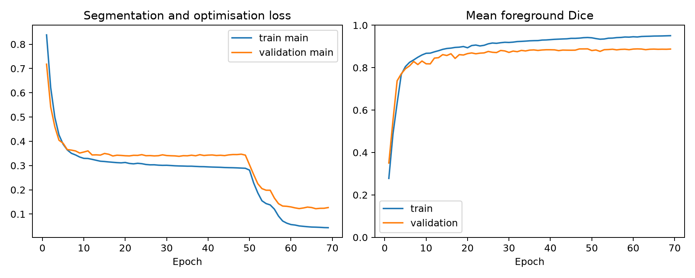 | 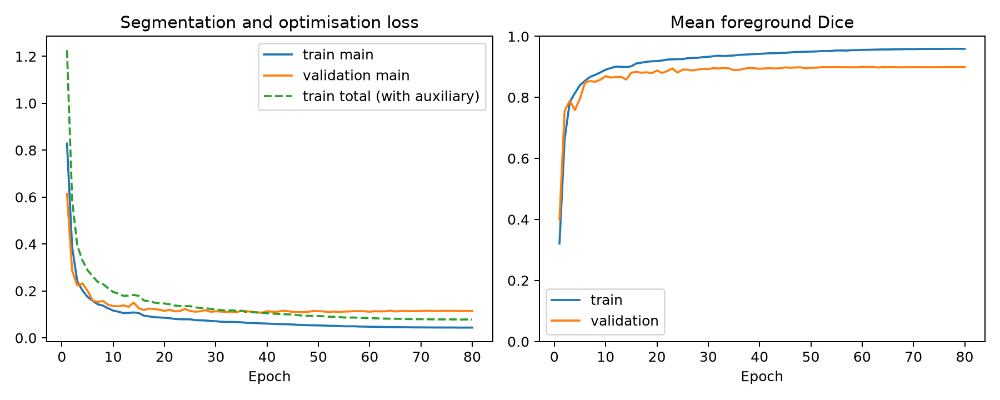 |

The separate 3D curves distinguish the main-output loss from the larger training objective that includes auxiliary losses. The auxiliary total should not be compared directly with the 2D loss. Even main losses have different slice/volume reduction units; assess performance using the common held-out metrics.

### Primary segmentation comparison

Metrics below are accumulated from the same 26 cases across five held-out patients. Dice and IoU are voxel-aggregated from the full test confusion matrix.

| Metric | 2D U-Net | 3D Improved U-Net | 3D - 2D |
|---|---:|---:|---:|
| Mean foreground Dice | **0.8698** | 0.8312 | -0.0386 |
| Mean foreground IoU | **0.7753** | 0.7250 | -0.0504 |
| Prostate Dice | 0.7679 | **0.7896** | +0.0217 |
| Prostate IoU | 0.6233 | **0.6524** | +0.0291 |
| Prostate boundary precision | 0.9206 | **0.9460** | +0.0254 |
| Prostate boundary recall | **0.9267** | 0.9167 | -0.0100 |
| Prostate boundary F1 | 0.9236 | **0.9311** | +0.0075 |

Both prostate scores exceeded the specification's reference thresholds: 0.75 for 2D U-Net and 0.70 for hard-difficulty 3D Improved U-Net. The 3D model's F1 gain came from higher boundary precision but slightly lower boundary recall. It placed a larger fraction of its predicted boundary near the reference, while covering a smaller fraction of the reference boundary. That trade-off is important: a higher F1 does not establish that under-contouring has been reduced, nor does it identify whether an error crosses into the bladder or rectum.

Boundary F1 uses a one-voxel Chebyshev tolerance on the **downsampled D,H,W grid**. It is not a one-millimetre surface metric and must not be interpreted as millimetre-level clinical accuracy.

### Per-class Dice and IoU

| Class | 2D Dice | 3D Dice | Dice delta | 2D IoU | 3D IoU | IoU delta |
|---|---:|---:|---:|---:|---:|---:|
| Background | 0.9835 | **0.9850** | +0.0014 | 0.9676 | **0.9703** | +0.0027 |
| Body | **0.9660** | 0.9648 | -0.0012 | **0.9342** | 0.9320 | -0.0022 |
| Bone | **0.9009** | 0.8969 | -0.0040 | **0.8197** | 0.8131 | -0.0066 |
| Bladder | **0.8564** | 0.6505 | -0.2059 | **0.7488** | 0.4820 | -0.2668 |
| Rectum | **0.8576** | 0.8541 | -0.0035 | **0.7507** | 0.7453 | -0.0054 |
| Prostate | 0.7679 | **0.7896** | +0.0217 | 0.6233 | **0.6524** | +0.0291 |

The prostate gain therefore cannot be presented as a general segmentation improvement. The 0.2059 reduction in bladder Dice dominates the lower mean foreground score and is clinically important because the bladder is an organ at risk. Bone and rectum also decline slightly. A model-selection rule based only on prostate Dice would conceal this failure.

### Depth-region prostate analysis

Regional Dice is calculated per case and then averaged over the 26 cases. Regions partition only slices containing ground-truth prostate. Predictions outside that slice span are excluded from these regional scores, although they remain penalised by whole-volume Dice/IoU. The supplementary extent analysis below counts these errors explicitly.

| Prostate region | 2D mean Dice | 3D mean Dice | 3D - 2D |
|---|---:|---:|---:|
| Depth-low end | 0.6614 | **0.7043** | +0.0429 |
| Central | 0.8055 | **0.8168** | +0.0113 |
| Depth-high end | 0.4918 | **0.5561** | +0.0643 |

The largest average gains occurred at both depth ends, especially depth-high, while the central gain was smaller. This is the pattern expected if neighbouring slices help at transitions, but it is not proof: residual blocks, deep supervision, dropout, width, and downsampling also changed. Nor can depth-low and depth-high be equated confidently with anatomical apex and base without a physical-space review by a qualified reader.

At case level, the 3D model improved whole-volume prostate Dice in **21 of 26** cases and worsened it in five. The distribution matters: improvements and failures were concentrated within repeated weeks from the same small set of patients, so 26 volumes must not be treated as 26 independent subjects.

### Prostate extent errors

A paired extent analysis evaluated both checkpoints on the same 26 test volumes and 64 x 128 x 128 grid using an NVIDIA A100-PCIE-40GB, PyTorch 2.13.0+cu130, and CUDA mixed precision. The aggregate overlap and boundary measures matched the primary evaluation. The counts below add information that global Dice cannot provide: whether prostate predictions extend beyond, or disappear within, the annotated slice span.

| Count across 26 volumes | 2D U-Net | 3D Improved U-Net |
|---|---:|---:|
| Predicted prostate voxels below the GT slice span | 544 | 261 |
| Predicted prostate voxels above the GT slice span | 360 | 78 |
| Total predicted prostate voxels outside the GT span | 904 | 339 |
| Extra predicted-prostate slices below the GT span | 30 | 17 |
| Extra predicted-prostate slices above the GT span | 28 | 8 |
| Total extra slices outside the GT span | 58 | 25 |
| GT-positive slices with no predicted prostate | 24 | 19 |
| Total GT-positive slices | 330 | 330 |

Counts use the downsampled evaluation grid, not native-resolution voxels or physical volumes. Below/above mean lower/higher depth indices relative to the first/last GT-positive slice; they are not inferred apex/base labels. An extra slice contains at least one predicted prostate voxel outside that span. A completely missed slice contains GT prostate but **no prostate prediction anywhere on the slice**; a misplaced prediction with zero overlap is not counted as complete absence. The per-case output also counts prostate voxels on all GT-empty slices, including any internal gaps. If a volume has no GT prostate, its span is undefined and its false positives are recorded only by that GT-empty-slice measure.

The 3D configuration produced fewer exterior prostate voxels (339 versus 904), fewer extra slices (25 versus 58), and fewer completely missed ground-truth-positive slices (19 versus 24). This is evidence of better extent control on this test cohort, but it neither establishes 3D context as the cause nor guarantees improvement for an individual scan. The counts are descriptive because repeated scans from five patients are not independent subjects.


### Resource profile

Both models were profiled on the same A100 with CUDA mixed precision, 64 x 128 x 128 inputs, and a 2D slice sub-batch of 16. Latency is the mean of one inference pass per test volume without an explicit warm-up, so the first CUDA cold start is included. CUDA was synchronised around the timed region, which covers the forward pass and conversion of logits to labels but excludes loading, preprocessing, metric calculation, and file writing. Memory is peak **PyTorch allocated memory**, not reserved memory or total board utilisation. The standalone inference peak was measured over the wider evaluation loop, including metrics and NIfTI export, rather than over an isolated forward pass. Decimal GB is calculated from MiB as `MiB * 1,048,576 / 1,000,000,000`.

| Resource | 2D U-Net | 3D Improved U-Net | 3D - 2D |
|---|---:|---:|---:|
| Trainable parameters | 7,762,630 | 5,908,434 | -1,854,196 (-23.9%) |
| Peak training allocation | 932.04 MiB (0.977 GB) | 1,526.64 MiB (1.601 GB) | +594.60 MiB (+0.623 GB; +63.8%) |
| Peak standalone inference allocation | 325.81 MiB (0.342 GB) | 523.97 MiB (0.549 GB) | +198.16 MiB (+0.208 GB; +60.8%) |
| Mean cold-inclusive standalone inference (ms/case) | 62.20 | 70.26 | +8.06 (+13.0%) |
| Completed epochs | 69 | 80 | +11 |
| Observed training-loop time (h) | 2.29 | 2.51 | +0.23 |

The 3D model has fewer parameters because it starts with half the base width, yet its volumetric feature maps require substantially more allocated memory. A separate warm profile that discarded the first case measured 33.57 ms/case for 2D and 30.97 ms/case for 3D. The reversal in ranking shows that these one-pass timing means are sensitive to warm-up and do not justify declaring either model faster. A defensible throughput comparison would use explicit warm-up, repeated trials, and a distributional summary such as median and interquartile range.

## Matched failure-case autopsy

Both checkpoints were rerun on the same five test cases at the same downsampled depth indices. This controls the anatomy shown in each comparison; selecting each model's independent worst slice would not be a matched comparison. Each panel contains the MRI, ground-truth mask, prediction, and error overlay. Red denotes prostate false positive, blue denotes prostate false negative, and yellow denotes disagreement in the other labels. A case remains a failure case when one model improves on the other because at least one displayed prediction is still incorrect.

| Case and slice | 2D volume Dice | 3D volume Dice | Volume delta | 2D slice Dice | 3D slice Dice | Main observation |
|---|---:|---:|---:|---:|---:|---|
| `W029_Week6:32` | 0.6948 | 0.5849 | -0.1099 | **0.9388** | 0.0000 | Severe 3D regression |
| `B037_Week0:35` | 0.7048 | 0.6513 | -0.0535 | **0.2033** | 0.1737 | Both under-contour; 3D is worse |
| `W029_Week4:29` | 0.5306 | 0.6091 | +0.0785 | 0.0000 | **0.4783** | 3D partially recovers a 2D miss |
| `M015_Week3:42` | 0.7284 | 0.8274 | +0.0990 | 0.0000 | **0.4444** | 3D partially recovers a 2D miss |
| `M015_Week0:42` | 0.7653 | 0.7795 | +0.0142 | **0.1304** | 0.0000 | Mixed result: volume gain, local 3D miss |

### Verified context of the five selected slices

Original-resolution MRI and GT labels were inspected at the corresponding native slice and its immediate neighbours, alongside the evaluation-grid panels below. Image and label affines agree, and all five volumes have LPS axis codes: increasing depth points superiorly. The table uses **annotated prostate extent**, without claiming a specialist identification of apex/base. All indices are zero-based. Native GT spans are W029_Week6 63–85, B037_Week0 42–79, W029_Week4 41–59, M015_Week3 52–84, and M015_Week0 56–85. Evaluation labels use nearest-neighbour resampling; selected depth indices map to native label slices 64, 70, 58, 84, and 84 respectively. MRI inputs use trilinear interpolation, so a displayed evaluation slice is not an exact copy of one native MRI slice.

| Selected case/slice | Verified location (evaluation GT span) | Observed error at selected slice | Possible explanation — hypothesis only |
|---|---|---|---|
| `W029_Week6:32` | Inferior annotated extent; first positive slice (32–42) | 3D misses prostate retained by 2D | Small terminal cross-section may be vulnerable to the configuration's downsampling and feature processing |
| `B037_Week0:35` | Central metric region, toward the superior part of span (21–39) | Both models under-contour the GT prostate | Local boundary appearance or annotation ambiguity may contribute; neither is established |
| `W029_Week4:29` | Superior annotated extent; last positive slice (21–29) | 2D misses prostate; 3D partially recovers it | Inter-slice context may help, but architectural differences also remain possible causes |
| `M015_Week3:42` | Superior annotated extent; last positive slice (26–42) | 2D misses prostate; 3D partially recovers it | A possible context benefit near the annotated transition, not an isolated causal effect |
| `M015_Week0:42` | Superior annotated extent; last positive slice (28–42) | Marked prostate under-contouring, including a local 3D miss | Small terminal region and nearby organ boundaries may contribute; no cause has been isolated |

Each figure shows the selected evaluation slice and one neighbour on either side, including slices beyond the ground-truth span where applicable. The numerical table and displayed panels were produced on Rangpur using an NVIDIA A100-PCIE-40GB and the same trained checkpoints. Colour legends identify organs and error types directly in each panel. Because the model grid is downsampled in depth, one native neighbouring slice represents a finer step than one evaluation-grid neighbour.

The neighbouring-slice panels expose a trade-off that the isolated slices hide. For W029_Week6, 2D predicts prostate one slice below the GT span (31), whereas 3D avoids that false positive but misses prostate at slices 32 and 33. For W029_Week4, 3D partially recovers slice 29 but also predicts prostate beyond the GT span at slice 30; 2D predicts none at either slice. Thus recovering a terminal GT region and avoiding over-extension are separate outcomes, which motivates reporting both regional Dice and the extent counts. A displayed Dice of 1.000 on a slice where both masks contain no prostate indicates correct absence, not successful segmentation of a prostate region.

### 1. W029_Week6:32 - largest 3D prostate regression

| Matched 2D U-Net | Matched 3D Improved U-Net |
|---|---|
| 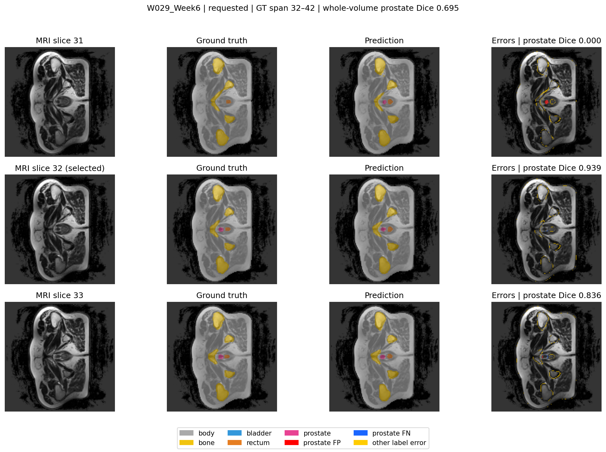 | 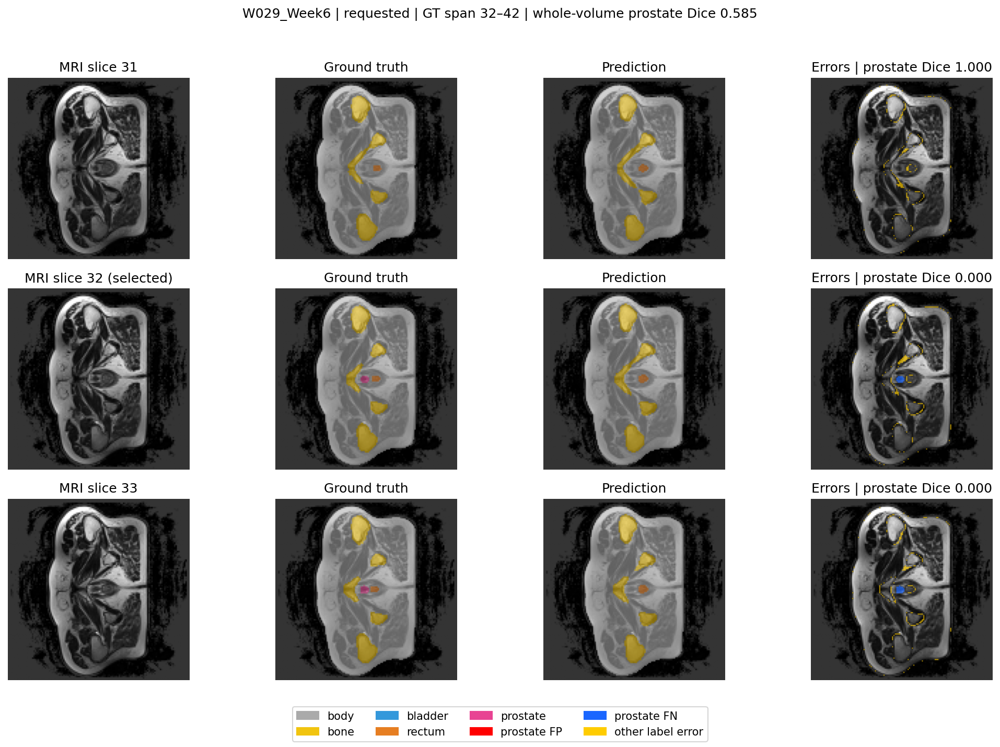 |

The 2D model closely matches the small prostate on slice 32 (Dice 0.9388), whereas the 3D model misses it completely (Dice 0.0000). Whole-volume prostate Dice also falls by 0.1099. This is a meaningful regression because the selected slice is the first positive slice of the annotated prostate extent, where the structure is still very small. The neighbouring-slice analysis also shows an interesting trade-off: the 2D model predicts some prostate one slice below the ground-truth span, while the 3D model avoids this false positive but then misses the true prostate on slices 32 and 33.

One plausible explanation is that the 3D model smooths the transition too aggressively. Because it combines neighbouring-slice information and repeatedly downsamples the volume, a very small terminal prostate region may become less prominent in deeper features. The 2D model, which evaluates the slice independently, may preserve strong local evidence even when neighbouring slices contain little or no prostate. This mechanism is consistent with the observed behaviour, although it was not isolated experimentally.

### 2. B037_Week0:35 - under-contouring by both models

| Matched 2D U-Net | Matched 3D Improved U-Net |
|---|---|
|  | 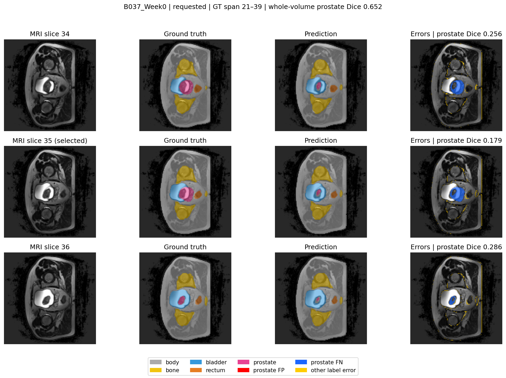 |

Both models retain only a small part of the larger ground-truth prostate, with slice Dice of 0.2033 for 2D and 0.1737 for 3D. Whole-volume Dice also decreases from 0.7048 to 0.6513 for the 3D model. Unlike the previous case, adding volumetric context does not solve the failure, suggesting that missing neighbouring information is not the main limitation here.

This pattern is more consistent with a difficult local appearance that affects both architectures. The prostate boundary may have weak contrast or resemble surrounding soft tissue after resizing, while neighbouring slices may contain similarly ambiguous information and therefore provide little extra benefit to the 3D model. Its smaller base width of 16 channels, compared with 32 in the 2D model, could also reduce fine-grained feature discrimination. These factors are possible contributors rather than confirmed causes.

### 3. W029_Week4:29 - 3D partially recovers a 2D miss

| Matched 2D U-Net | Matched 3D Improved U-Net |
|---|---|
| 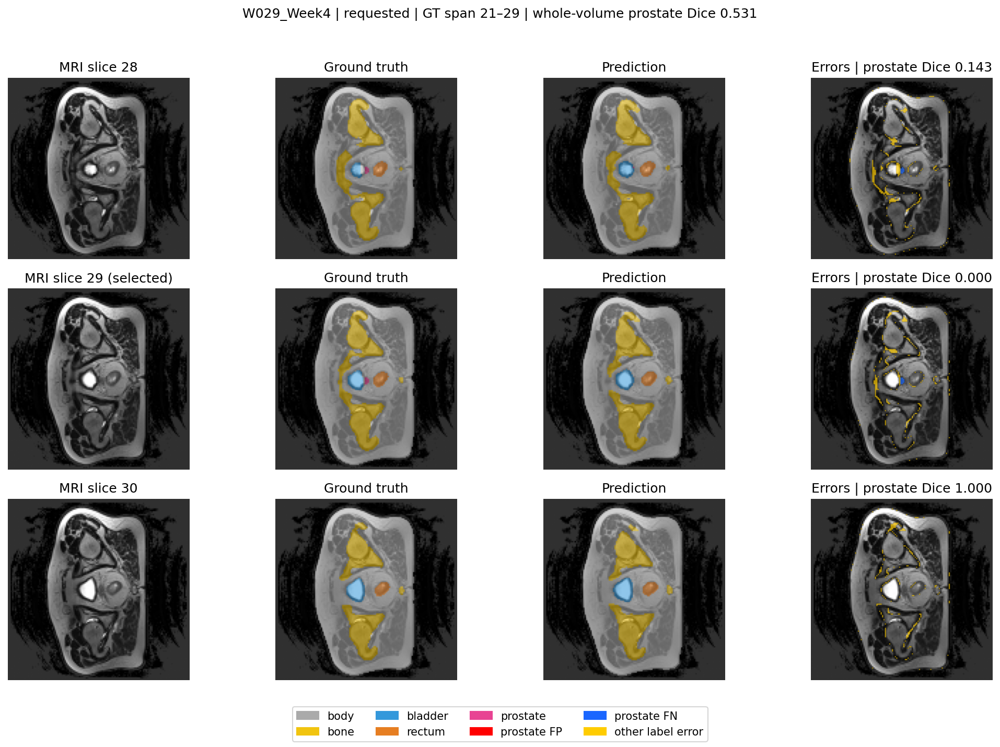 | 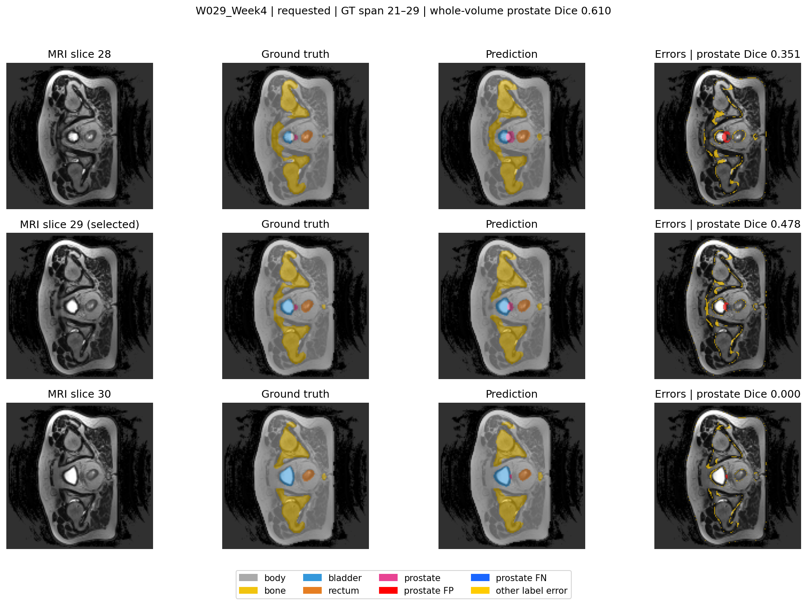 |

The 2D model completely misses the small prostate on the selected slice (Dice 0.0000), while the 3D model recovers part of it (Dice 0.4783) and improves whole-volume Dice by 0.0785. The selected slice is the final positive slice of the annotated prostate extent, where the cross-section becomes small and may provide only weak visual evidence when considered independently.

The architecture provides one possible explanation for the improvement. The 3D model can use neighbouring slices where the prostate is more clearly visible and interpret the small region as a continuation of the same structure, while the 2D model cannot access this information. However, the 3D model also predicts prostate on the following slice outside the ground-truth span. This suggests that the same volumetric continuity that helps recover a terminal region can also cause the prediction to extend beyond the correct boundary.

### 4. M015_Week3:42 - 3D partially recovers another 2D miss

| Matched 2D U-Net | Matched 3D Improved U-Net |
|---|---|
| 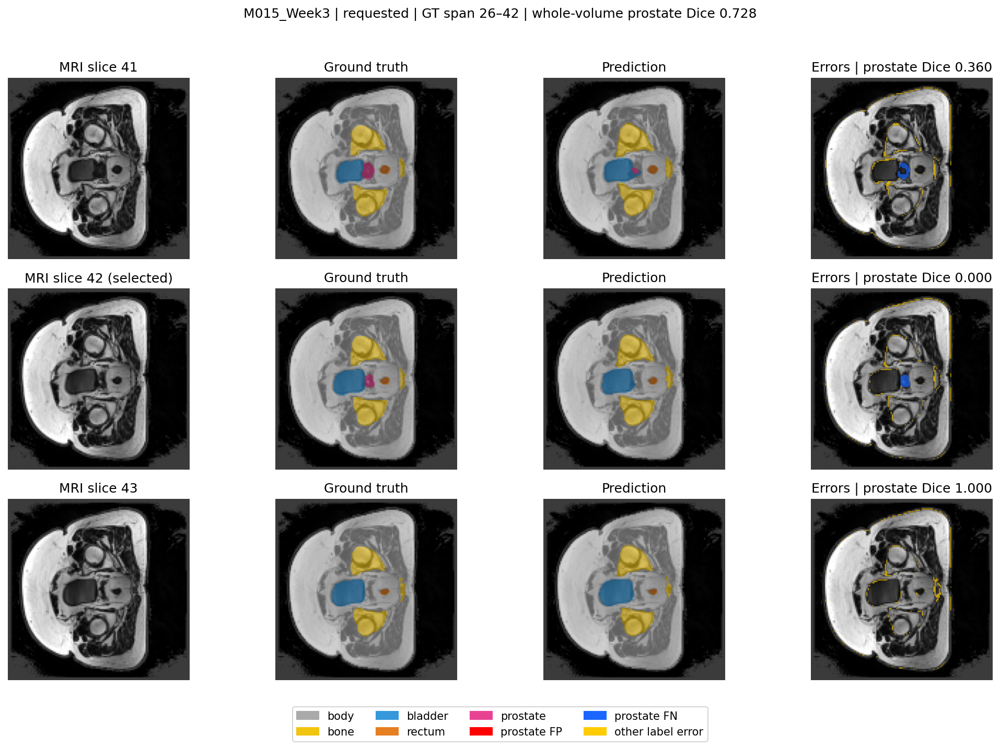 | 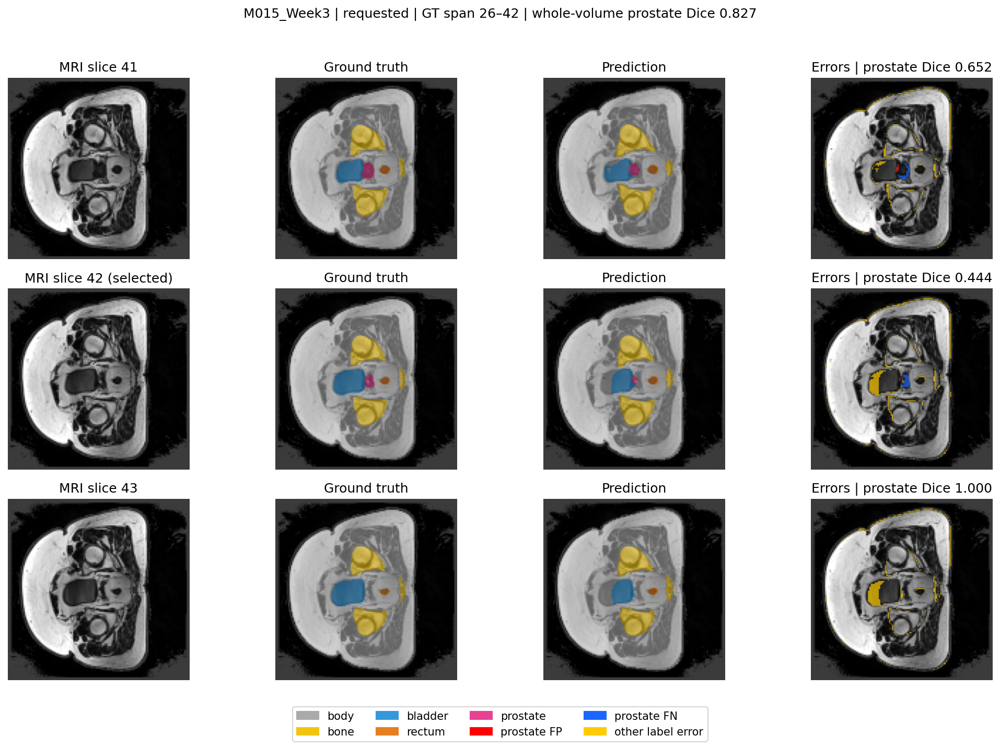 |

The 2D model again produces a complete false negative on the selected terminal slice (Dice 0.0000), while the 3D model recovers an incomplete prostate contour with Dice 0.4444. Whole-volume Dice also improves substantially from 0.7284 to 0.8274. This repeated pattern is consistent with the aggregate results, where the 3D model shows larger improvements near the depth ends than in the central prostate region.

A likely contributing factor is the availability of neighbouring-slice information. Volumetric features may help the 3D model maintain the approximate location of the prostate as the organ becomes smaller near the end of its extent, while the independent 2D model loses that contextual cue. The recovery is still incomplete, which may indicate that resizing and repeated downsampling remove some of the spatial detail needed to preserve these very small terminal regions.

### 5. M015_Week0:42 - whole-volume gain hides a local and organ-at-risk failure

| Matched 2D U-Net | Matched 3D Improved U-Net |
|---|---|
| 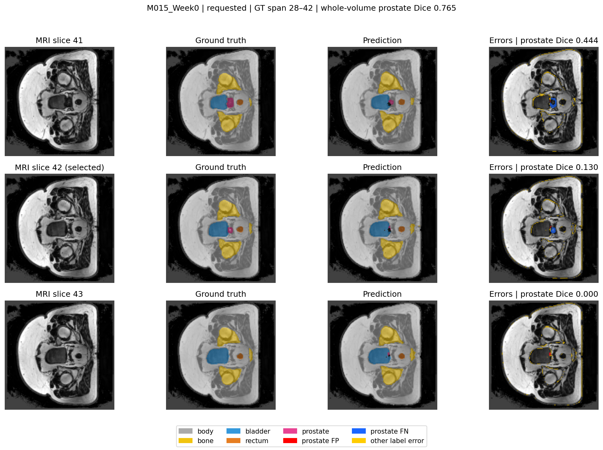 | 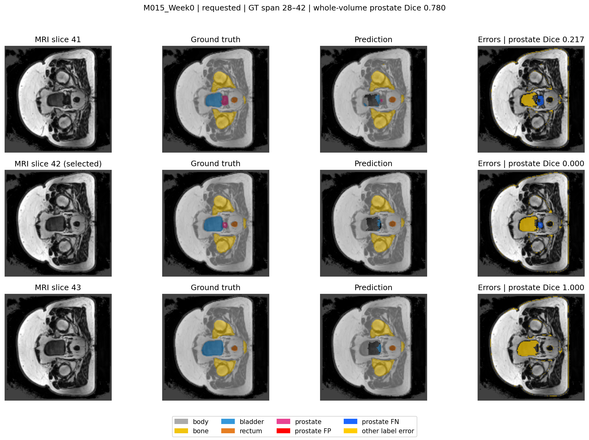 |

Although the 3D model achieves slightly higher whole-volume prostate Dice (0.7795 versus 0.7653), the selected-slice Dice decreases from 0.1304 to 0.0000. Both models under-contour the small prostate, while the 3D prediction also shows greater disagreement around the bladder. This is particularly important because the overall bladder Dice also falls substantially for the 3D model, from 0.8564 to 0.6505. Therefore, the local error is consistent with a wider multi-organ weakness rather than being only an isolated visual failure.

One interpretation is that the 3D configuration trades some fine local boundary discrimination for stronger volumetric consistency. Its smaller channel width, repeated volumetric downsampling and multi-scale supervision may preserve the broader prostate structure while losing detail at difficult prostate–bladder interfaces. This could help explain why prostate performance improves overall while bladder segmentation deteriorates. A controlled ablation would still be needed to determine whether channel width, downsampling, deep supervision or another architectural difference is mainly responsible.

## Cross-case interpretation

Across the five matched cases, the 3D model appears most useful when the prostate becomes small near the end of its annotated extent and neighbouring slices provide additional spatial context. This is consistent with the larger average 3D gains at the depth-low and depth-high regions compared with the central region. However, the same volumetric continuity can still fail in individual cases: it may suppress a real terminal prostate region, as in W029_Week6, or extend a prediction beyond the ground-truth span, as in W029_Week4, despite the 3D model producing fewer out-of-span predictions overall across the test cohort. The cases therefore suggest a trade-off between slice-wise local sensitivity and volumetric consistency rather than a simple advantage of 3D processing. These patterns are consistent with a possible benefit from neighbouring-slice information, but the current experiment cannot attribute them solely to 3D context because channel width, residual blocks, dropout, deep supervision and downsampling also differ between the models. differ between the models.

## Discussion and engineering recommendation

Taken together, the experiment gives a qualified answer to the research question. The 3D configuration is associated with better prostate overlap, boundary precision, average performance at both ends of the annotated extent, and fewer out-of-span predictions. The gain is therefore not limited to central slices. However, it is modest at the aggregate level, heterogeneous across cases, and cannot be attributed specifically to 3D context because several architectural factors changed together.

The 3D Improved U-Net should **not yet replace the 2D U-Net as a general multi-organ contouring assistant**. It met the hard-model prostate target and improved prostate Dice by 0.0217, prostate IoU by 0.0291, boundary F1 by 0.0075, depth-low Dice by 0.0429, and depth-high Dice by 0.0643. Whole-volume prostate Dice improved in 21 of 26 volumes, and the model used 5.91 million parameters. Those positive counts must be interpreted against only five independent test patients and several severe local regressions.

In the same comparison, the 3D configuration used 63.8% more peak training allocation and 60.8% more standalone inference allocation. Its cold-inclusive standalone latency mean was 13.0% higher, but the warm-profile ranking reversed; these timings therefore do not support a speed-based recommendation. More importantly, bladder Dice fell from 0.8564 to 0.6505 and several prostate cases regressed severely. In radiotherapy planning, a model that improves the target but degrades an adjacent organ at risk is not an acceptable autonomous replacement.

The evidence supports retaining the 3D model as a **research-stage prostate contour proposal** with mandatory specialist review and keeping the 2D baseline as the stronger measured multi-organ research fallback. Neither model has demonstrated clinical safety. A prediction should be routed for explicit review when it has any of the following observable conditions:

- an empty prostate on a slice between neighbouring non-empty prostate slices;
- disconnected prostate components or an abrupt end-slice volume change;
- strong disagreement between the 2D and 3D contours near prostate–bladder or prostate–rectum interfaces
- a large disagreement between 2D and 3D prostate contours;
- missing or implausibly small bladder, rectum, or prostate predictions.

These are proposed review flags, not an implemented or validated triage system. No numerical rejection threshold is claimed because it has not been calibrated on an independent validation cohort. Before translation, the next work should investigate the bladder failure, perform physical-space surface metrics such as 95th-percentile Hausdorff distance and surface Dice in millimetres, calibrate rejection rules on validation patients, and test an external patient cohort.

## Threats to validity and intended use

- Only 38 patients were available, with five patients in the test set. Repeated weekly scans are correlated observations.
- The configurations differ in several architectural and training choices; observed performance differences cannot be attributed to 3D context alone without controlled ablations.
- Each configuration was trained once with one random seed. Variation across initialisations was not measured.
- Volumes were downsampled to 64 x 128 x 128, which can remove thin or very small structures.
- Per-class aggregate metrics are voxel-weighted and can be dominated by larger cases.
- Depth regions are coordinate partitions, not manually verified anatomical apex/base annotations.
- Boundary F1 is evaluated in downsampled voxels, not millimetres.
- Peak allocated memory is not the same as total GPU VRAM utilisation.
- The latency experiment used a single pass per case and was not designed as a statistically robust throughput benchmark.
- No external validation, calibration study, or prospective clinical usability study was performed.

This is coursework research code, not a medical device. Every prediction requires expert review and must not be used for treatment planning.

## Artificial Intelligence Usage Disclosure

I used OpenAI Codex to assist with scaffolding and reviewing the data-loading, training, and evaluation code; planning Rangpur runs; checking metric reporting; developing failure-case tools; and organising this README. It also helped identify issues that required manual verification, including patient leakage, foreground-only MRI normalisation, NIfTI orientation, interpolation choice, loss comparability, and matched case selection.

AI assistance did not generate the measurements reported here. I checked the deterministic patient split and orientation audit, confirmed that both evaluations contained the same 26 volumes from the same five patients, recomputed aggregate comparisons from per-case outputs, and manually reviewed the failure panels. I remain responsible for the implementation, the reported results, and the interpretation of every claim in this report.

## Verification

Development checks covered tensor shapes, finite backward gradients, removal of auxiliary heads during inference, patient separation, saved-manifest validation, foreground normalisation, exact-mask and tolerance-aware metrics, extent-error counting, memory-unit conversion, and timing calculations. `predict.py` is the executable test driver; it loads a checkpoint, validates the saved split, runs held-out inference, reports metrics, exports NIfTI predictions, and generates the visual error panels documented above.


## References

1. O. Ronneberger, P. Fischer, and T. Brox, "U-Net: Convolutional Networks for Biomedical Image Segmentation," in *MICCAI 2015, Part III*, LNCS 9351, pp. 234-241, 2015. [doi:10.1007/978-3-319-24574-4_28](https://doi.org/10.1007/978-3-319-24574-4_28).
2. Ö. Çiçek, A. Abdulkadir, S. S. Lienkamp, T. Brox, and O. Ronneberger, "3D U-Net: Learning Dense Volumetric Segmentation from Sparse Annotation," in *MICCAI 2016, Part II*, LNCS 9901, pp. 424-432, 2016. [doi:10.1007/978-3-319-46723-8_49](https://doi.org/10.1007/978-3-319-46723-8_49).
3. F. Isensee, P. Kickingereder, W. Wick, M. Bendszus, and K. H. Maier-Hein, "Brain Tumor Segmentation and Radiomics Survival Prediction: Contribution to the BRATS 2017 Challenge," in *Brainlesion: Glioma, Multiple Sclerosis, Stroke and Traumatic Brain Injuries (BrainLes 2017)*, LNCS 10670, pp. 287-297, published 2018. [doi:10.1007/978-3-319-75238-9_25](https://doi.org/10.1007/978-3-319-75238-9_25).


